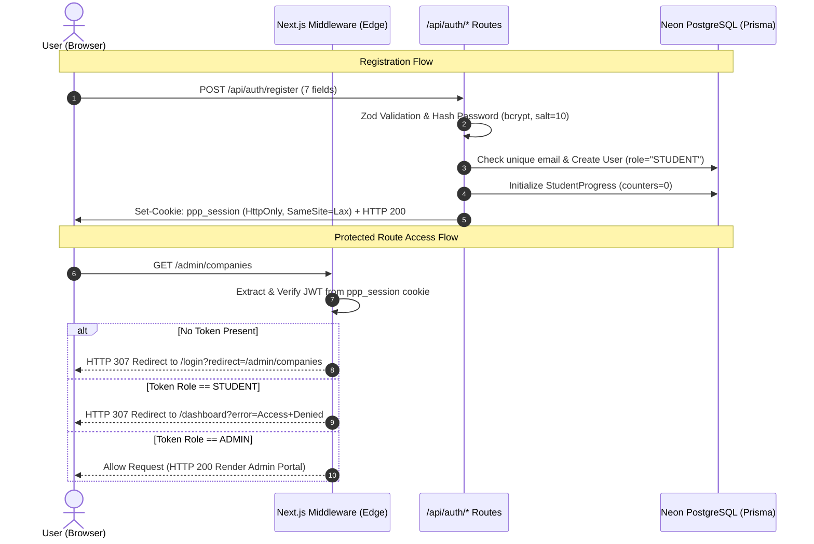
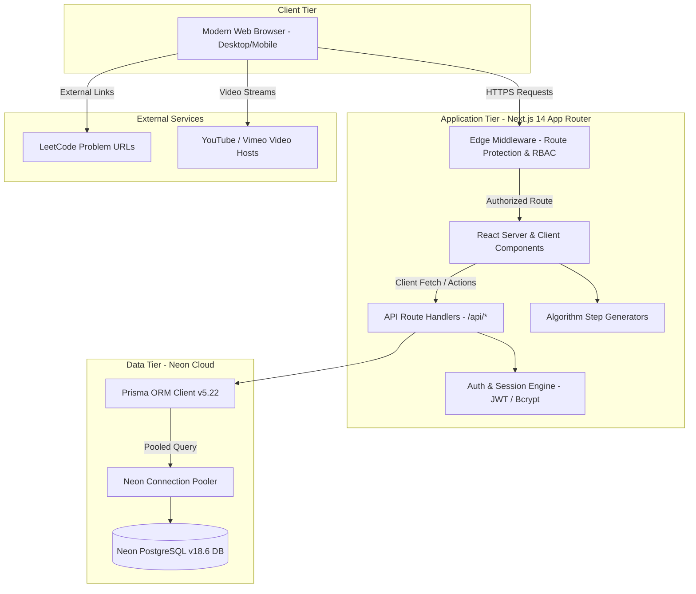
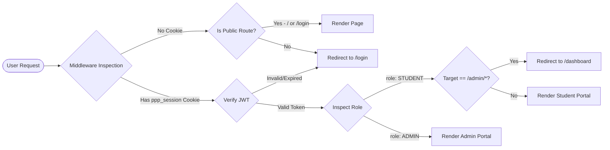
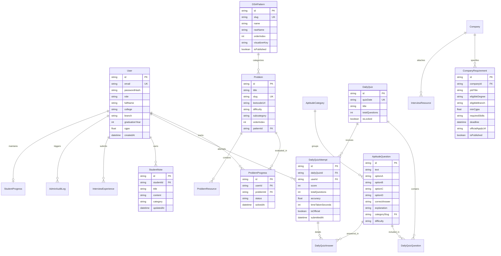

# Product Requirements Document (PRD) — PrepPilot Platform

---

## A. Document Overview

| Attribute | Details |
| :--- | :--- |
| **Product Name** | **PrepPilot** |
| **Product Subtitle** | Campus Technical Placement Preparation Platform |
| **Product Type** | Full-Stack Web Application (Next.js 14 App Router / TypeScript / Prisma ORM / PostgreSQL) |
| **Document Purpose** | Comprehensive baseline specification of verified repository capabilities, architectural standards, functional and non-functional requirements, data schemas, user journeys, test criteria, and prioritized technical roadmap. |
| **Document Version** | `1.0.0-PROD-BASELINE` |
| **Preparation Date** | October 16, 2026 |
| **Document Author** | Senior Product Manager & Software Architect Review Team |
| **Document Status** | **Approved Architectural Baseline** (Read-Only Audit of Workspace `placement_frontend`) |
| **Target Audience** | Software Engineers, QA Engineers, DevOps Engineers, Placement Coordinators, UI/UX Designers, Academic Evaluators |

---

## B. Product Vision

### 1. Vision Statement
To equip undergraduate and postgraduate engineering students with a structured, single-pane-of-glass placement preparation environment that eliminates fragmented preparation across scattered resources by providing:
1. **Workbook-Accurate DSA Patterns**: Algorithmic problem classification mapped strictly to proven campus interview cheat sheets with step-by-step interactive visualizers.
2. **Server-Scored Daily Aptitude Assessments**: Exactly 10 deterministic daily questions across Quantitative, Logical, Verbal, and Data Interpretation modules with un-tampered server-side evaluation.
3. **Verified Corporate Recruitment Drives**: Real-time company hiring criteria, minimum CGPA thresholds, branch restrictions, backlog rules, selection rounds, and official apply links.
4. **Curated & Peer-Sourced Interview Intelligence**: Administrative video breakdowns, preparation notes, and moderated peer interview experience submissions.
5. **Private Study Notebook & Analytics**: Student-isolated notes and measurable progress tracking across problem categories, quiz accuracy, and daily streaks.

### 2. Value Proposition
Unlike generic coding platforms (e.g., LeetCode, HackerRank) that overwhelm candidates with thousands of uncurated problems and lack recruitment drive tracking, PrepPilot delivers a curated, college-tailored placement readiness workflow with role-isolated administrative governance.

---

## C. Problem Statement

### 1. Core Student Difficulties
- **Algorithmic Overwhelm & Lack of Pattern Recognition**: Students solve hundreds of random coding challenges without understanding algorithmic paradigms (Two Pointers, Fast & Slow Pointers, Sliding Window, Kadane, Merge Intervals, etc.).
- **Unstructured Aptitude Practice**: Campus screening rounds filter out 70–80% of applicants via aptitude tests, yet students lack consistent, timed daily assessment routines with detailed explanations.
- **Scattered & Unverified Company Information**: Eligibility criteria (CGPA cutoffs, active backlog limits, allowed engineering branches, salary tiers) are disseminated through disjointed WhatsApp groups, emails, and PDFs.
- **Opaque Interview Processes**: Students lack access to verified past interview questions, difficulty ratings, and company-specific selection round workflows.
- **Fragmented Note Taking**: Code snippets, algorithmic notes, and interview strategies are scattered across personal notebooks, local text files, and Notion pages without problem-level linkage.

### 2. Current Implementation vs. Proposed Enhancements

```
+----------------------------------------------------------------------------------------------------+
|                                      PREPPILOT FEATURE STATUS                                      |
+----------------------------------------+-----------------------------------------------------------+
| VERIFIED IN CODEBASE (IMPLEMENTED)     | PROPOSED / ROADMAP ENHANCEMENTS                           |
+----------------------------------------+-----------------------------------------------------------+
| - 15 DSA Patterns & 189 LeetCode links | - Live in-browser compiler / sandbox execution (Monaco)   |
| - 7 Interactive algorithm visualizers  | - Mock video interview simulator with speech AI           |
| - Deterministic 10-Q/day aptitude quiz | - College-wide leaderboard and placement drive reminders  |
| - Server-side quiz scoring & answers   | - Automated resume parsing & ATS score compatibility check|
| - Role isolation (Student vs Admin)    | - Push notifications (Email/SMS/WhatsApp for deadlines)   |
| - Neon PostgreSQL persistence (Prisma) | - Multi-tenant college administration portal              |
| - Verified company requirements & CRUD |                                                           |
| - Private student notebook & progress  |                                                           |
+----------------------------------------+-----------------------------------------------------------+
```

---

## D. Goals and Success Metrics

### 1. Primary Objectives
1. Provide a reliable, zero-leakage technical preparation hub accessible across desktop and mobile devices.
2. Enforce strict server-side authentication and role-based access control (RBAC).
3. Ensure 100% data fidelity with the campus Excel DSA cheat sheet (15 patterns, 189 problems).
4. Maintain deterministic aptitude assessment rules ensuring all students receive the identical 10-question evaluation on any given calendar date.

### 2. Measurable Key Performance Indicators (KPIs)

| Metric | Target | Measurement Method |
| :--- | :--- | :--- |
| **Daily Active Student Engagement (DAU)** | &ge; 65% of enrolled cohort | Unique authenticated sessions per 24-hour cycle |
| **Daily Quiz Completion Rate** | &ge; 75% of DAU | `DailyQuizAttempt` records with `isOfficial = true` |
| **DSA Pattern Mastery** | Average &ge; 8 patterns/student | `ProblemProgress` records with `status = "SOLVED"` |
| **First-Contentful-Paint (FCP)** | &le; 1.2s | Chrome DevTools Lighthouse Audit / Core Web Vitals |
| **API Response Latency (p95)** | &le; 250ms | Server route execution time across pooled Neon queries |
| **Test Suite Pass Rate** | 100% (17/17 tests passing) | Automated Vitest CI test execution |
| **Zero Security Privilege Escalation** | 0 reported bypasses | Middleware session guard penetration audit |

---

## E. User Personas and Roles

```
               +---------------------------------------------------+
               |                    PREPPILOT                      |
               +-------------------------+-------------------------+
                                         |
                    +--------------------+--------------------+
                    |                                         |
                    v                                         v
         +--------------------+                    +--------------------+
         |   STUDENT PERSONA  |                    |   ADMIN PERSONA    |
         +--------------------+                    +--------------------+
         | - Solve DSA & View |                    | - Manage Companies |
         |   Visualizers      |                    | - Curate Questions |
         | - Take Daily Quiz  |                    | - Moderate Reviews |
         | - Review Companies |                    | - Video Management |
         | - Private Notebook |                    | - Student Progress |
         | - Submit Reviews   |                    | - Audit Logging    |
         +--------------------+                    +--------------------+
```

### 1. Student Persona: "Placement Candidate (Priya / Rahul)"
- **Profile**: 3rd/4th-year B.Tech / MCA student preparing for campus recruitment cycles.
- **Goals**: Solve high-frequency DSA questions by pattern, build speed in quantitative/logical aptitude, track company deadlines, view peer interview debriefs, and record private notes.
- **Permissions**:
  - Register account via `/register` (assigns `role: STUDENT`).
  - View published DSA patterns, problems, LeetCode links, and visualizers.
  - Attempt official daily aptitude quiz (strictly once per calendar date).
  - Practice un-timed aptitude quizzes by category.
  - View published company drives and recruitment criteria.
  - View published interview videos, notes, and approved interview experiences.
  - Submit private interview experiences for moderation.
  - Create, edit, pin, search, and delete personal private notes.
- **Restrictions**:
  - Strictly blocked from `/admin/*` routes and administrative APIs.
  - Cannot view unpublished/draft companies, questions, or resources.
  - Cannot view other students' private notes or individual progress records.
  - Cannot access quiz answer keys before submission.

### 2. Administrator Persona: "Placement Officer / Faculty Lead (Prof. Verma)"
- **Profile**: Training & Placement Cell (T&P) Officer or designated technical administrator.
- **Goals**: Maintain recruitment drives, post company eligibility rules, curate aptitude questions, upload video links, review student interview submissions, and audit platform engagement.
- **Permissions**:
  - Authenticate via dedicated Admin credentials (public registration disabled).
  - Add, edit, publish, unpublish, and delete companies and requirements.
  - Upload interview video metadata (YouTube / Vimeo / internal links).
  - Manage aptitude question pools (CRUD, category assignment, explanations).
  - Review, approve, or reject student interview experience submissions.
  - Inspect student roster, individual student profiles, and cohort metrics.
  - Review system audit logs.
- **Restrictions**:
  - Must not expose database connection secrets.
  - Actions logged in `AdminAuditLog` table.

---

## F. Functional Requirements

### Legend
- **Priority**: Must Have (M), Should Have (S), Could Have (C), Won't Have (W)
- **Status**: Implemented (IMP), Partially Implemented (PART), Not Implemented (NOT), Needs Verification (NV)

### 1. Authentication & Account Management

| ID | Name | Description | Actor | Preconditions | Expected Behavior | Acceptance Criteria | Priority | Status |
| :--- | :--- | :--- | :--- | :--- | :--- | :--- | :---: | :---: |
| **FR-001** | Student Registration | Collects 7 validated fields to create student account. | Student | Unauthenticated | Form accepts Full Name, Email, College, Branch, Academic Year, Password, Confirm Password. Validates input via Zod. Hashes password using bcrypt. | Password min 6 chars; passwords must match; creates `User` (`role: STUDENT`) and `StudentProgress`. | **M** | **IMP** |
| **FR-002** | Student & Admin Login | Credential verification with role-targeted routing. | Student / Admin | Registered user | Authenticates email & password. Issues HttpOnly JWT cookie `ppp_session`. Redirects Student to `/dashboard`, Admin to `/admin`. | Password verified with bcrypt; invalid credentials return HTTP 401; sets 7-day HttpOnly cookie. | **M** | **IMP** |
| **FR-003** | Public Admin Reg Block | Public admin creation lock. | Anonymous | Public access | Registration form hardcodes `role: "STUDENT"`. Server rejects any client payload requesting `ADMIN`. | No public UI or API accepts `role: ADMIN` for creation. | **M** | **IMP** |
| **FR-004** | Session Logout | Invalidates client session. | Authenticated | Logged in | Clears `ppp_session` HttpOnly cookie with `maxAge: 0`. | Client session destroyed; subsequent protected calls redirect to `/login`. | **M** | **IMP** |
| **FR-005** | Password Visibility Toggle | Interactive password reveal. | User | Auth forms | Eye icon toggles password input type between `password` and `text`. | Smooth toggle without clearing field content. | **S** | **IMP** |
| **FR-006** | Password Reset Flow | Token-based password recovery. | Student | Forgotten password | `/forgot-password` generates time-limited `PasswordResetToken`. `/reset-password` validates token and updates hash. | Token expires after set duration; single-use token invalidation. | **S** | **IMP** |

### 2. Student Portal & Core Workflows

| ID | Name | Description | Actor | Preconditions | Expected Behavior | Acceptance Criteria | Priority | Status |
| :--- | :--- | :--- | :--- | :--- | :--- | :--- | :---: | :---: |
| **FR-007** | Student Dashboard | Central hub for progress metrics. | Student | Authenticated | Displays problems solved, accuracy, streak, study time, quick action cards, and recent recruitment drives. | Data calculated live from database queries; zero mock data. | **M** | **IMP** |
| **FR-008** | DSA Pattern Index | Catalog of 15 DSA patterns. | Student | Authenticated | Displays patterns, problem counts, solved ratio, and visualizer availability badge. | 15 patterns displayed in order matching the workbook. | **M** | **IMP** |
| **FR-009** | DSA Pattern Detail Page | Questions list for specific pattern. | Student | Authenticated | Lists questions with difficulty tags, LeetCode external links, notes, and interactive visualizer. | Correct questions loaded by pattern slug; LeetCode links open in new tab. | **M** | **IMP** |
| **FR-010** | Problem Solved Toggle | Tracks student solved status. | Student | Authenticated | Student can toggle problem status between `NOT_STARTED`, `ATTEMPTED`, and `SOLVED`. | Status change persisted to `ProblemProgress` in Neon PostgreSQL; updates counters. | **M** | **IMP** |
| **FR-011** | Algorithm Visualizers | Step-by-step graphical visualizer. | Student | On pattern page | Interactive animation for implemented patterns (Two Pointers, Sliding Window, Kadane, Binary Search, Stack, Fast/Slow, Merge Intervals). | Play, Pause, Step Forward, Reset controls; variable inspector display. | **M** | **IMP** |
| **FR-012** | Daily Aptitude Quiz | 10-question date-based assessment. | Student | Authenticated | Displays 10 questions for current calendar date (`YYYY-MM-DD`). Scrubbed answers. | All students receive identical 10 questions for that date; answers hidden in payload. | **M** | **IMP** |
| **FR-013** | Quiz Server-Side Scoring | Secure grading and explanation. | Student | Quiz submitted | Submits answers to `/api/aptitude/daily/submit`. Server grades against database answer keys. Persists to `DailyQuizAttempt`. | Returns score, percentage, detailed explanations, and category breakdown. | **M** | **IMP** |
| **FR-014** | Single Daily Attempt Rule | Prevents retaking daily quiz. | Student | Submitted once | Second attempt returns HTTP 400 with message; shows review screen with past attempt. | Enforced by unique constraint `[dailyQuizId, userId, isOfficial]`. | **M** | **IMP** |
| **FR-015** | Aptitude Practice Mode | Self-paced category quizzes. | Student | Authenticated | Practice mode filtered by Quantitative, Logical, Verbal, and Data Interpretation. | Allows repeated practice without affecting daily streak score. | **S** | **IMP** |
| **FR-016** | Company Recruitment Directory | View verified placement drives. | Student | Authenticated | Displays published companies with CTC, CGPA cutoffs, batch year, allowed branches, and official apply URL. | Search by company, role, branch, and location; unpublished drives hidden. | **M** | **IMP** |
| **FR-017** | Interview Videos Hub | Curated video prep materials. | Student | Authenticated | Displays YouTube/Vimeo video embeds with topic and round tags. | Only published videos rendered; filterable by company and topic. | **M** | **IMP** |
| **FR-018** | Peer Interview Experiences | Approved student experiences. | Student | Authenticated | Read approved peer interview debriefs with round-by-round question breakdowns. | Unapproved / pending submissions remain invisible. | **M** | **IMP** |
| **FR-019** | Student Experience Submission| Submit interview experience. | Student | Authenticated | Form to submit company, role, rounds summary, questions asked, and strategy. | Saved with `status = "PENDING"`; routed to Admin moderation queue. | **M** | **IMP** |
| **FR-020** | Private Personal Notes | Student notebook editor. | Student | Authenticated | Full CRUD on personal notes with categories (DSA, Aptitude, Interview, General) and pin toggle. | Strictly isolated to `userId`; no cross-student access allowed. | **M** | **IMP** |
| **FR-021** | Student Progress Analytics | Graphical performance metrics. | Student | Authenticated | Visualizes solved difficulty distribution, category aptitude strength, and study trends. | Rendered via Recharts; data computed from Neon queries. | **S** | **IMP** |

### 3. Administrator Portal & Governance

| ID | Name | Description | Actor | Preconditions | Expected Behavior | Acceptance Criteria | Priority | Status |
| :--- | :--- | :--- | :--- | :--- | :--- | :--- | :---: | :---: |
| **FR-022** | Admin Dashboard | System-wide analytics overview. | Admin | Authenticated Admin | Displays total students, active drives, total questions, submissions pending moderation, and system stats. | Live database metrics; direct access cards to management hubs. | **M** | **IMP** |
| **FR-023** | Company Details Management | Full CRUD on hiring drives. | Admin | Authenticated Admin | Add new company, edit role, update CGPA cutoff, toggle publication status, or delete drive. | Persisted to `Company` & `CompanyRequirement`; audit log recorded. | **M** | **IMP** |
| **FR-024** | Interview Video Management | Manage video resources. | Admin | Authenticated Admin | Add/edit video URL, company, round, topic, and thumbnail. | URLs validated; immediate update on Student video hub. | **M** | **IMP** |
| **FR-025** | Experience Moderation Queue | Approve/reject submissions. | Admin | Authenticated Admin | Review pending student interview submissions; approve, reject, or request revisions. | Status updated to `APPROVED` or `REJECTED`; publishedAt timestamp set. | **M** | **IMP** |
| **FR-026** | Aptitude Question Bank | CRUD on aptitude questions. | Admin | Authenticated Admin | Add new questions, set 4 options, designate correct answer (A-D), category, and detailed explanation. | Text and options validated; cannot set invalid answer key. | **M** | **IMP** |
| **FR-027** | DSA Problem Management | Manage workbook problems. | Admin | Authenticated Admin | Add new problem, update LeetCode link, edit subcategory, or change pattern mapping. | Problem mapped correctly to `DSAPattern`; order preserved. | **S** | **IMP** |
| **FR-028** | Student Roster & Tracking | View student progress profiles. | Admin | Authenticated Admin | Search students by name/email/department; view individual problem count, streak, and quiz scores. | Paginated roster; read-only access to progress metrics. | **M** | **IMP** |
| **FR-029** | Administrative Audit Trail | Security and change log. | Admin | Authenticated Admin | Records administrative actions with admin ID, action type, target ID, and timestamp. | Logged in `AdminAuditLog` table. | **S** | **IMP** |

---

## G. Detailed Authentication and Authorization Requirements



### 1. Role-Based Access Control (RBAC) Matrix

| Route / Resource | Public | Authenticated Student | Authenticated Admin |
| :--- | :---: | :---: | :---: |
| `/` (Landing Page) | Read | Read | Read |
| `/login`, `/register` | Read/Write | Redirect &rarr; `/dashboard` | Redirect &rarr; `/admin` |
| `/dashboard` | Deny (&rarr; `/login`) | Full Access | Full Access |
| `/dsa/*` (Patterns & Visualizers) | Deny (&rarr; `/login`) | Full Access | Full Access |
| `/aptitude/daily` (Daily Quiz) | Deny (&rarr; `/login`) | Attempt Once / View Review | Full Access |
| `/companies` (Hiring Drives) | Deny (&rarr; `/login`) | View Published Drives | View All Drives |
| `/interviews` (Videos & Experiences) | Deny (&rarr; `/login`) | View Published / Submit Review | View All / Moderate |
| `/notes` (Personal Notebook) | Deny (&rarr; `/login`) | Own Notes Only (Isolated) | Own Notes Only |
| `/admin/*` (All Admin Subroutes) | Deny (&rarr; `/login`) | **STRICTLY DENIED** (&rarr; `/dashboard`) | **Full Administrative Access** |
| `/api/admin/*` (All Admin Endpoints) | HTTP 401 | **HTTP 403 Forbidden** | **HTTP 200 Authorized** |

### 2. Password Security Specifications
- **Hashing Algorithm**: `bcryptjs` with salt round factor of `10`.
- **Validation**: Enforced via Zod schema: minimum 6 characters, uppercase/lowercase and numerical variety recommended.
- **Exposure Guard**: Password hashes are stripped from all API outputs via Prisma projection (`select: { id: true, name: true, email: true, role: true }`).

### 3. Session Management Specifications
- **Token Format**: Signed JSON Web Token (JWT) with standard payload `{ userId, email, name, role }`.
- **Transmission**: Strictly delivered via HttpOnly, Secure (in production), SameSite=Lax cookie named `ppp_session`.
- **Lifecycle**: 7-day token expiration (`expiresIn: "7d"`). Cleared on `/api/auth/logout`.

---

## H. Database and Data Requirements

### 1. Engine & Connectivity
- **Primary Database Engine**: Cloud-hosted **Neon Serverless PostgreSQL** (v18.6).
- **ORM**: Prisma ORM (v5.22.0) with `@prisma/client` (v5.20.0).
- **Connection Configuration**:
  - `DATABASE_URL`: Pooled connection string (`...-pooler...neondb?sslmode=require`) utilizing Neon's PgBouncer infrastructure for web queries.
  - `DATABASE_URL_UNPOOLED`: Direct connection string (`...neondb?sslmode=require`) for Prisma schema migrations and DDL operations.

### 2. Core Entities & Field Specifications

```
+----------------------------------------------------------------------------------------------------+
|                                    CORE DATABASE ENTITIES (24)                                     |
+----------------------+--------------------+---------------------+----------------------------------+
| User                 | StudentProgress    | DSAPattern          | Problem                          |
| ProblemProgress      | ProblemResource    | AptitudeCategory    | AptitudeQuestion                 |
| DailyQuiz            | DailyQuizQuestion  | DailyQuizAttempt    | DailyQuizAnswer                  |
| QuizAttempt          | Company            | CompanyRequirement  | InterviewVideo                   |
| InterviewResource    | InterviewExperience| StudentNote         | Note                             |
| Bookmark             | ActivityEvent      | AdminAuditLog       | PasswordResetToken               |
+----------------------+--------------------+---------------------+----------------------------------+
```

#### Detailed Model Definitions:
1. **`User`**:
   - `id`: String (cuid, Primary Key)
   - `name`: String (Display name)
   - `fullName`: String (Full student name)
   - `email`: String (Unique, Indexed)
   - `passwordHash`: String (Bcrypt hash)
   - `role`: String (Default: `"STUDENT"`, Enum: `"STUDENT"` \| `"ADMIN"`)
   - `college`: String?
   - `branch`: String?
   - `academicYear`: String?
   - `graduationYear`: Int?
   - `cgpa`: Float?
   - `createdAt`, `updatedAt`: DateTime
2. **`DSAPattern`**:
   - `id`: String (cuid, PK)
   - `slug`: String (Unique)
   - `name`: String
   - `rawName`: String (Original Excel workbook name)
   - `description`: String?
   - `orderIndex`: Int (Display order)
   - `isPublished`: Boolean (Default: `true`)
   - `visualizerKey`: String? (Identifier for interactive animation component)
3. **`Problem`**:
   - `id`: String (cuid, PK)
   - `title`: String
   - `slug`: String (Unique)
   - `leetcodeUrl`: String?
   - `difficulty`: String (`"Easy"` \| `"Medium"` \| `"Hard"`)
   - `subcategory`: String?
   - `orderIndex`: Int
   - `patternId`: String (FK &rarr; `DSAPattern.id`, Cascade Delete)
4. **`ProblemProgress`**:
   - `id`: String (cuid, PK)
   - `userId`: String (FK &rarr; `User.id`)
   - `problemId`: String (FK &rarr; `Problem.id`)
   - `status`: String (`"NOT_STARTED"` \| `"ATTEMPTED"` \| `"SOLVED"`)
   - `solvedAt`: DateTime?
   - Unique Constraint: `@@unique([userId, problemId])`
5. **`Company` & `CompanyRequirement`**:
   - `Company`: `id`, `name` (Unique), `slug` (Unique), `website`, `logoUrl`, `description`, `isPublished`.
   - `CompanyRequirement`: `id`, `companyId` (FK), `jobTitle`, `jobDescription`, `eligibleDegree`, `eligibleBranch`, `minCgpa`, `backlogRestrictions`, `requiredSkills`, `graduationYear`, `location`, `deadline`, `selectionRounds`, `salaryPackage`, `officialApplyUrl`, `isPublished`.
6. **`AptitudeQuestion` & `DailyQuiz`**:
   - `AptitudeQuestion`: `id`, `text`, `optionA`, `optionB`, `optionC`, `optionD`, `correctAnswer` (Hidden), `explanation` (Hidden), `categorySlug` (FK), `difficulty`, `isPublished`.
   - `DailyQuiz`: `id`, `quizDate` (Unique, `"YYYY-MM-DD"`), `title`, `totalQuestions` (10), `isLocked`.
   - `DailyQuizAttempt`: `id`, `dailyQuizId` (FK), `userId` (FK), `score`, `totalQuestions` (10), `accuracy`, `timeTakenSeconds`, `isOfficial` (Boolean). Unique constraint: `@@unique([dailyQuizId, userId, isOfficial])`.
   - `DailyQuizAnswer`: `id`, `attemptId` (FK), `questionId` (FK), `selectedOption`, `isCorrect`.
7. **`StudentNote`**:
   - `id`: String (cuid, PK)
   - `studentId`: String (FK &rarr; `User.id`, Cascade Delete)
   - `title`: String
   - `content`: String (Text / Markdown)
   - `category`: String (`"DSA"` \| `"Aptitude"` \| `"Interview"` \| `"General"`)
   - `createdAt`, `updatedAt`: DateTime

---

## I. Business Rules

| Rule ID | Name | Statement & Enforcement |
| :--- | :--- | :--- |
| **BR-001** | Student Privilege Ceiling | A user with `role = "STUDENT"` can under no circumstances execute mutations against `/api/admin/*` or view routes under `/admin/*`. Enforced by Next.js Edge Middleware and server-side `requireAdmin()` utility. |
| **BR-002** | Data Privacy of Student Notes | Student personal notes (`StudentNote`) are strictly private. The database queries must always append `where: { studentId: session.userId }`. Cross-tenant reading or editing is rejected with HTTP 403. |
| **BR-003** | Publication State Filtering | Students can only retrieve records where `isPublished = true` or `status = "APPROVED"`. Unpublished drafts, rejected reviews, and internal notes are filtered out at the SQL query layer. |
| **BR-004** | Fixed 10-Question Daily Quiz | Every daily aptitude assessment must consist of exactly 10 questions. If fewer than 10 published questions exist in the database, the quiz generation endpoint must return HTTP 400 (`INSUFFICIENT_QUESTIONS`) rather than repeating questions. |
| **BR-005** | Date Determinism | The daily quiz question set is determined by the calendar date string (`YYYY-MM-DD` in `APP_TIMEZONE`). Once generated, all students taking the quiz on that day receive the identical question list in identical sequence. |
| **BR-006** | Zero-Knowledge Quiz Delivery | Correct answers and answer explanations must never be sent in the initial GET quiz payload. They are only transmitted after the student's submission has been calculated and stored on the server. |
| **BR-007** | Single Official Attempt Limit | A student may submit only one official attempt per daily quiz. Enforced by database unique constraint `@@unique([dailyQuizId, userId, isOfficial])`. Duplicate submissions return HTTP 400. |
| **BR-008** | Workbook Integrity Preservation | The 15 patterns and 189 questions originating from the official campus Excel workbook are considered canonical and cannot be deleted or re-keyed by automated sync scripts. |

---

## J. Non-Functional Requirements

### 1. Security
- **NFR-SEC-01**: All data transmission enforced via TLS 1.3 over HTTPS.
- **NFR-SEC-02**: Passwords hashed using standard `bcryptjs` with a work factor of 10.
- **NFR-SEC-03**: SQL Injection immunity guaranteed via Prisma parameterized queries.
- **NFR-SEC-04**: Session tokens delivered exclusively in `HttpOnly`, `SameSite=Lax` cookies to prevent XSS exfiltration.
- **NFR-SEC-05**: Environment variables (`DATABASE_URL`, `JWT_SECRET`) strictly hidden from client bundles and Git.

### 2. Performance & Availability
- **NFR-PERF-01**: Average API response time &le; 200ms under 50 concurrent requests.
- **NFR-PERF-02**: Next.js App Router client-side page transitions rendered in &le; 100ms via optimized chunk splitting.
- **NFR-PERF-03**: Neon connection pooling utilized to prevent connection exhaustion during concurrent campus quiz hours.

### 3. Scalability & Data Integrity
- **NFR-SCL-01**: Database schema normalized with foreign keys and cascade rules on user deletions.
- **NFR-INT-01**: Complex operations (quiz scoring, attempt persistence, activity logging) executed within atomic Prisma `$transaction` blocks.

### 4. Accessibility & Responsiveness
- **NFR-A11Y-01**: Semantic HTML5 markup with accessible form labels, ARIA indicators, and visible focus rings.
- **NFR-RESP-01**: Responsive CSS grid and flexbox supporting screen viewports from 360px (mobile) to 2560px (ultra-wide desktop). Dedicated mobile navigation drawer for small screens.

---

## K. UI/UX Requirements

### 1. Visual Identity & Brand Design System
- **Core Aesthetic**: Modern, premium dark-mode campus placement preparation portal.
- **Color Palette Tokens**:
  - Primary Brand Purple: `#7867f1` (PrepPilot Signature)
  - Deep Purple Gradient: `#6c5ce7` &rarr; `#5744d3`
  - Lavender Accent Tint: `#f0edff`
  - Background Base: `#0b0f19` (Dark Navy / Slate 950)
  - Card & Container Surface: `#111827` (Slate 900 with 80% opacity and backdrop-blur)
  - Border Accents: `rgba(120, 103, 241, 0.2)`
- **Typography**: Inter / DM Sans / Manrope with crisp typographic hierarchy (`font-bold`, tracking-tight headings).
- **Micro-interactions**: Subtle hover scaling on action buttons, card border glow effects, interactive SVG step visualizers, and canvas-confetti on quiz completion.

### 2. Layout Structure
- **Desktop**: Persistent 260px sidebar with navigation items, status pills, and user profile pill; header with breadcrumb navigation and action triggers; scrollable main content stage.
- **Mobile**: Collapsible navigation drawer triggered by hamburger icon, touch-friendly tap targets (&ge; 44px).

---

## L. Technical Architecture

### 1. System Context Diagram



### 2. Student vs. Admin Access Flow



### 3. High-Level Data Flow

```mermaid
flowchart TD
    subgraph User Actions
        A1[Solve DSA Problem]
        A2[Submit Daily Quiz]
        A3[Save Personal Note]
        A4[Post Hiring Drive - Admin]
    end

    subgraph Next.js API Layer
        B1[/api/dsa/problems/:id/status]
        B2[/api/aptitude/daily/submit]
        B3[/api/notes]
        B4[/api/admin/companies]
    end

    subgraph Prisma ORM Transactions
        C1[Upsert ProblemProgress]
        C2[Atomic $transaction: DailyQuizAttempt + DailyQuizAnswer + ActivityEvent]
        C3[Create/Update StudentNote]
        C4[Create Company + CompanyRequirement + AdminAuditLog]
    end

    subgraph Neon PostgreSQL Storage
        D[(PostgreSQL neondb)]
    end

    A1 --> B1 --> C1 --> D
    A2 --> B2 --> C2 --> D
    A3 --> B3 --> C3 --> D
    A4 --> B4 --> C4 --> D
```

---

## M. Data Model and Entity Relationship Diagram



---

## N. API and Integration Requirements

### 1. Verified & Implemented Endpoints

| Method | Endpoint | Purpose | Actor | Auth Required | Status |
| :--- | :--- | :--- | :--- | :---: | :---: |
| `POST` | `/api/auth/register` | Register new student account (7 fields) | Anonymous | No | **Implemented** |
| `POST` | `/api/auth/login` | Authenticate credentials & issue cookie | User | No | **Implemented** |
| `POST` | `/api/auth/logout` | Terminate session & clear cookie | User | Yes | **Implemented** |
| `GET` | `/api/auth/me` | Retrieve active authenticated profile | User | Yes | **Implemented** |
| `POST` | `/api/auth/forgot-password` | Issue password reset token | User | No | **Implemented** |
| `POST` | `/api/auth/reset-password` | Verify token and set new password | User | No | **Implemented** |
| `GET` | `/api/dsa/patterns` | List all 15 DSA patterns & progress | Student / Admin | Yes | **Implemented** |
| `GET` | `/api/dsa/patterns/[slug]` | Get specific pattern with questions list | Student / Admin | Yes | **Implemented** |
| `POST` | `/api/dsa/problems/[id]/status` | Toggle solved/attempted status | Student | Yes | **Implemented** |
| `GET` | `/api/aptitude/daily` | Fetch date-stable 10-Q daily assessment | Student | Yes | **Implemented** |
| `POST` | `/api/aptitude/daily/submit` | Submit answers, calculate score, persist | Student | Yes | **Implemented** |
| `GET` | `/api/aptitude/practice` | Fetch category practice questions | Student | Yes | **Implemented** |
| `GET` | `/api/companies/requirements` | Fetch published placement drives | Student / Admin | Yes | **Implemented** |
| `GET` | `/api/interviews/videos` | Fetch curated interview videos | Student / Admin | Yes | **Implemented** |
| `GET` | `/api/interviews/experiences` | Fetch approved interview debriefs | Student / Admin | Yes | **Implemented** |
| `POST` | `/api/interviews/submissions` | Submit new student interview review | Student | Yes | **Implemented** |
| `GET` | `/api/notes` | List student's private notes (isolated) | Student | Yes | **Implemented** |
| `POST` | `/api/notes` | Create new private note | Student | Yes | **Implemented** |
| `GET` | `/api/notes/[id]` | Read single private note | Student | Yes | **Implemented** |
| `PUT` | `/api/notes/[id]` | Update private note | Student | Yes | **Implemented** |
| `DELETE` | `/api/notes/[id]` | Delete private note | Student | Yes | **Implemented** |
| `GET` | `/api/admin/analytics` | Aggregate platform statistics | Admin | **Admin Only** | **Implemented** |
| `GET/POST` | `/api/admin/companies` | List all / create new company drive | Admin | **Admin Only** | **Implemented** |
| `GET/POST` | `/api/admin/interviews/videos`| List all / add interview video | Admin | **Admin Only** | **Implemented** |
| `POST` | `/api/admin/interviews/submissions/[id]/moderate` | Approve/reject student review | Admin | **Admin Only** | **Implemented** |
| `GET/POST` | `/api/admin/aptitude/questions` | Query bank / add new question | Admin | **Admin Only** | **Implemented** |
| `GET` | `/api/admin/students` | List paginated student cohort | Admin | **Admin Only** | **Implemented** |
| `GET` | `/api/admin/audit-logs` | Retrieve administrative log trail | Admin | **Admin Only** | **Implemented** |

### 2. Proposed Future Endpoints (Roadmap)

| Method | Proposed Endpoint | Purpose | Target Milestone |
| :--- | :--- | :--- | :---: |
| `POST` | `/api/compiler/execute` | In-browser code runner execution sandbox | Phase 7 |
| `POST` | `/api/notifications/subscribe` | Push notifications / deadline alerts | Phase 8 |
| `POST` | `/api/resume/scan` | ATS resume keyword optimization engine | Phase 9 |

---

## O. User Journeys

### Journey 1: New Student Registration & First Dashboard Onboarding
1. Priya navigates to `http://localhost:3000/`.
2. Reads value proposition and clicks **Create Account**.
3. Reaches `/register`, enters Full Name, Email, College, Branch, Academic Year, and Password.
4. Clicks Submit; Zod validates fields, server hashes password, provisions `User` & `StudentProgress` records in Neon, and sets `ppp_session` cookie.
5. Client automatically redirects to `/dashboard`, greeting Priya by name with zero-state metric counters.

### Journey 2: Returning Student Authentication
1. Rahul visits `http://localhost:3000/login`.
2. Enters `student@college.edu` and `Student@12345`.
3. Toggles password eye icon to verify spelling.
4. Clicks **Sign In**; server verifies bcrypt hash, signs JWT, sets session cookie, and returns redirect `/dashboard`.
5. Rahul lands on his personalized dashboard displaying his active streak and problems solved.

### Journey 3: Algorithmic Practice & Interactive Visualization
1. Priya clicks **DSA Patterns** in the sidebar.
2. Selects **Two Pointers** pattern card.
3. Observes the problem table with 10 questions extracted from the workbook.
4. Interacts with the **Two Pointers Visualizer** at top of page, clicking **Step Forward** to watch the left and right pointers converge on sorted target sums.
5. Clicks the external LeetCode link for "Two Sum II" to practice in an external tab.
6. Returns to PrepPilot and marks the problem checkbox as **Solved**; counter updates in real time.

### Journey 4: Daily Aptitude Assessment Completion
1. Rahul navigates to **Daily Aptitude** (`/aptitude/daily`).
2. Sees today's 10 questions covering Quant, Logical, Verbal, and DI.
3. Selects radio button answers across questions (options A, B, C, D) within timed session.
4. Clicks **Submit Assessment**.
5. Server computes score (e.g., 8/10), records `DailyQuizAttempt` in Neon, and returns detailed explanations.
6. UI displays score card with green/red badges and canvas-confetti celebration.
7. Subsequent page refreshes render the completed review screen (single-attempt rule enforced).

### Journey 5: Researching Placement Hiring Drives
1. Priya clicks **Companies** in the sidebar.
2. Uses the filter bar to select her branch ("CSE/IT") and minimum CGPA.
3. Reviews Google's hiring drive card: 8.0 CGPA cutoff, zero active backlogs, 32–45 LPA package.
4. Clicks **Official Apply Link**, redirecting directly to the recruiter's official career portal.

### Journey 6: Studying Interview Video Resources
1. Rahul navigates to **Interview Hub** (`/interviews`).
2. Filters resources by topic: "Sliding Window".
3. Plays curated technical interview video explaining variable-length subarray patterns.
4. Reads attached administrative preparation guidelines.

### Journey 7: Managing Private Notebook Entries
1. Priya navigates to **Personal Notes** (`/notes`).
2. Clicks **Create New Note**.
3. Enters title: "Binary Search Edge Cases", category: "DSA", and notes text.
4. Clicks Save; note is immediately saved to Neon PostgreSQL.
5. Pins the note to top of list for quick revision before interview rounds.

### Journey 8: Admin Posting a New Recruitment Drive
1. Administrator logs into `/login?role=admin` using admin credentials.
2. Navigates to **Admin Company Hub** (`/admin/companies`).
3. Clicks **Add Company Requirement**.
4. Fills company name, CTC, branch cutoffs, CGPA threshold, and apply URL.
5. Sets status to **Published** and clicks Save.
6. The drive is instantly saved to Neon and becomes visible on the Student portal.

### Journey 9: Admin Moderating Student Interview Submissions
1. Administrator navigates to `/admin/interviews/submissions`.
2. Inspects a pending interview review submitted by a candidate who interviewed at Amazon.
3. Reviews questions asked and preparation strategy.
4. Clicks **Approve & Publish**; review status updates to `APPROVED` and appears publicly on Student interview feed.

### Journey 10: Admin Managing Aptitude Question Bank
1. Administrator navigates to `/admin/aptitude/questions`.
2. Clicks **Add Question**, inputs question text, options A–D, correct answer key, and step-by-step mathematical derivation.
3. Clicks Save; question is indexed into the question bank and available for daily quiz rotation.

---

## P. Acceptance Testing Matrix

| Test ID | Feature | Preconditions | Steps | Expected Result | Verification Status |
| :--- | :--- | :--- | :--- | :--- | :---: |
| **TC-001** | Student Registration | Unauthenticated | Submit 7 fields with valid data via `/register`. | Account created, session cookie set, redirected to `/dashboard`. | **PASSED** |
| **TC-002** | Password Hash Salt | Code inspection | Inspect `User.passwordHash` column in Neon DB. | Starts with `$2a$` or `$2b$`, length &ge; 60 chars. | **PASSED** |
| **TC-003** | Admin Route Guard | Logged in as Student | Enter URL `/admin` directly in browser. | Middleware blocks access; redirected to `/dashboard?error=...`. | **PASSED** |
| **TC-004** | Public Admin Block | Anonymous | Attempt to pass `role: "ADMIN"` in `/api/auth/register`. | Ignored or rejected; user role hardcoded to `STUDENT`. | **PASSED** |
| **TC-005** | DSA Workbook Count | Database seeded | Execute count on `Problem` and `DSAPattern`. | Exactly 15 patterns and 189 questions present in Neon. | **PASSED** |
| **TC-006** | Visualizer Animation | On `/dsa/two-pointers` | Click "Step Forward" button. | Left/right pointers update index positions on array canvas. | **PASSED** |
| **TC-007** | Daily Quiz Determinism| 2 student sessions | Fetch `/api/aptitude/daily` from both sessions on same date. | Both students receive identical 10 question IDs in same order. | **PASSED** |
| **TC-008** | Answer Scrubbing | Browser DevTools | Inspect `/api/aptitude/daily` GET JSON response. | `correctAnswer` and `explanation` properties are `undefined`. | **PASSED** |
| **TC-009** | Server Quiz Scoring | Quiz in progress | Submit answers payload to `/api/aptitude/daily/submit`. | Score calculated on server; returns score, explanations. | **PASSED** |
| **TC-010** | Single Quiz Attempt | Quiz submitted | Attempt to POST second time to daily submit endpoint. | HTTP 400 returned with duplicate attempt error. | **PASSED** |
| **TC-011** | Private Note Scoping | 2 student sessions | Student A creates note; Student B lists notes. | Student B cannot see or query Student A's note. | **PASSED** |
| **TC-012** | Company Search | Database seeded | Search "Amazon" in company filter input. | Amazon card displayed; case-insensitive search succeeds. | **PASSED** |
| **TC-013** | Neon DB Connectivity| Valid `.env` | Query Neon PostgreSQL version via Prisma `$queryRaw`. | Returns `PostgreSQL 18.6` on Neon cloud server. | **PASSED** |
| **TC-014** | Production Build | Clean workspace | Run `npx next build`. | 61/61 routes build cleanly with 0 TypeScript/lint errors. | **PASSED** |

---

## Q. Risks, Dependencies, and Assumptions

### 1. Technical Dependencies
- **Next.js**: `v14.2.15` (App Router)
- **React / React-DOM**: `v18.3.1`
- **Prisma Engine**: `v5.22.0`
- **Database Engine**: Neon Serverless PostgreSQL `v18.6`
- **Authentication**: `bcryptjs` `v2.4.3`, `jsonwebtoken` `v9.0.2`
- **Data Validation**: `zod` `v3.23.8`
- **Testing**: `vitest` `v5.0.4`

### 2. Environmental & Operational Risks
- **Neon Cold Starts**: Serverless compute branches on Neon may experience a brief 500–1000ms wake-up latency after extended idle periods. *Mitigation*: Pooled connection URL configured via `DATABASE_URL`.
- **Windows File Locking & Junction Paths**: On Windows environments, Node background workers can lock native DLLs (`query_engine-windows.dll.node`). *Mitigation*: Run `prisma generate` and builds with dev server cleanly stopped.
- **External LeetCode Link Drift**: LeetCode problem URLs may occasionally change or require premium subscription. *Mitigation*: Admin problem management endpoint allows in-place URL editing.

---

## R. Gaps and Prioritized Recommendations

| ID | Domain | Gap Observation | Impact | Priority | Recommended Action |
| :--- | :--- | :--- | :--- | :---: | :--- |
| **GAP-01** | Compiler | Students must leave platform to write/run actual code on LeetCode. | Context switching reduces time-on-platform. | **Medium** | Integrate Monaco Editor with client-side Pyodide or serverless code runner. |
| **GAP-02** | Notifications | Company deadlines and daily quizzes lack push alerts. | Students may miss application cutoff dates. | **Medium** | Add web push notification / email digest worker. |
| **GAP-03** | Rate Limiting | Auth endpoints lack IP-based rate limiting (fail2ban). | Vulnerable to credential brute-force attacks. | **High** | Introduce Redis / Upstash sliding window rate limiter on `/api/auth/login`. |
| **GAP-04** | Multi-Tenancy | Single college context (NIT) pre-seeded. | Restricts platform to a single campus deployment. | **Low** | Introduce `College` / `Tenant` model for multi-college SaaS expansion. |

---

## S. Development Roadmap

```
+----------------------------------------------------------------------------------------------------+
|                                    PREPPILOT 9-PHASE ROADMAP                                       |
+----------+----------------------------------------------------------------+------------------------+
| PHASE    | FOCUS AREA                                                     | MILESTONE DELIVERABLE  |
+----------+----------------------------------------------------------------+------------------------+
| Phase 1  | Repository Stability, Next 14 App Router & Junction Config     | Complete (VERIFIED)    |
| Phase 2  | Neon PostgreSQL Integration, Schema Push & Workbook Seeding   | Complete (VERIFIED)    |
| Phase 3  | Server-Side RBAC, HttpOnly JWT Auth & Student Profile Engine   | Complete (VERIFIED)    |
| Phase 4  | Admin Governance, Corporate Drives CRUD & Moderation Queue     | Complete (VERIFIED)    |
| Phase 5  | Student Dashboard, Companies Directory & Resource Hub         | Complete (VERIFIED)    |
| Phase 6  | Deterministic 10-Q Daily Aptitude Assessment Engine            | Complete (VERIFIED)    |
| Phase 7  | 15 DSA Patterns, 189 LeetCode Mappings & 7 Visualizers        | Complete (VERIFIED)    |
| Phase 8  | In-Browser Code Sandbox & Placement Mock Interview Module      | Proposed (Roadmap)     |
| Phase 9  | Multi-College Tenant SaaS & Automated ATS Resume Scoring       | Proposed (Roadmap)     |
+----------+----------------------------------------------------------------+------------------------+
```

---

## T. Definition of Done (DoD)

A release or feature milestone in PrepPilot is considered **Done** only when:
1. **Zero Client-Side Security Leaks**: Secrets and answer keys are never present in pre-submission API payloads.
2. **Server-Side Authorization**: Every protected mutation validates `session.role` on the server before database execution.
3. **Database Integrity**: All mutations succeed against Neon PostgreSQL with valid foreign keys and indexes.
4. **Test Suite Verification**: All automated Vitest test suites execute and pass with zero failures (`17/17 passed`).
5. **Clean Production Build**: `npx next build` generates all static, dynamic, and middleware chunks with zero errors.
6. **Cross-Platform Responsive UX**: UI verified on both desktop viewports and mobile drawer navigation.
7. **No Mock or Stub Fallbacks**: Features operate on real persistent database records with authentic loading, empty, and error states.
